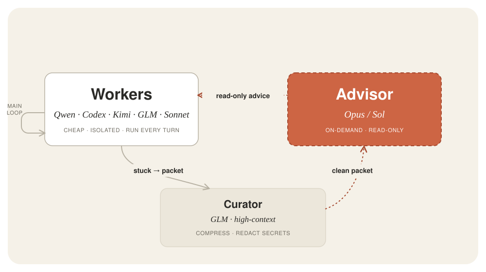

# askup

> An advisory channel for delegated AI workers. When a cheap worker gets stuck, it can **ask up** — escalate a curated problem to a stronger model — instead of guessing.

**Status: v0.1 implemented.** `npm install -g askup` (or `npx askup`), then `askup init` → `askup doctor` → `askup consult`. Security-first (see below). See [`docs/architecture.md`](docs/architecture.md) and [`docs/threat-model.md`](docs/threat-model.md).

---

## The problem

A good multi-model workflow looks like this:

> **A frontier orchestrator model drives the conversation and owns every decision.** To save tokens, it delegates *clear, well-specified tasks* to cheaper mid-tier workers — hosted or local. Work comes back and is **verified** — by the orchestrator, and cross-checked by other reviewers. This works well.

But there's a gap: **the workers can't talk to each other.** An agentic session can spawn an advisory subagent when it's stuck. A worker running in a tool loop, or a model inside a sandbox, cannot — it's isolated. When such a worker hits something above its weight class, it either **guesses** (bad) or **dead-ends** (wasteful).

`askup` is the missing channel: a worker packages its problem, a **curator** model compresses the mess into clean evidence, and the whole thing **escalates to a higher-tier advisor**. The advisor answers; the worker continues. Ownership never leaves the orchestrator.

## How it works



Cheap workers do the typing. When one is **stuck**, it asks up: a high-context **curator** redacts secrets and compresses the mess into a clean packet, then a stronger **advisor** reviews it **read-only** and answers. The worker keeps going — the decision never leaves the orchestrator.

Any engine can open it:
- a Claude-style worker via a subagent,
- a Codex/GPT-style worker via a CLI call (or a peer advisor),
- an Ollama worker via a `consult_advisor` tool in its loop.

## Quickstart

```bash
npm install -g askup
askup init            # detects claude/codex/ollama, writes ./askup.yaml
askup doctor          # verifies each configured model is reachable AND available
echo "Why is my nightly job dropping rows?" | askup consult
```

### The stdin protocol

Question and context always arrive on **stdin**, never argv — argv leaks to any other process on
the box via `ps`. Two accepted shapes:

- JSON: `{"question": "...", "context": "..."}`
- Plain text: first line is the question, the rest is context.

```bash
askup consult --context - <<'EOF'
Why is my nightly job dropping rows?
It's a Postgres COPY into a partitioned table, no errors logged, ~2% of rows missing.
EOF
```

### Example output (abridged)

```
=== askup recommendation ===
advisor: gemma3:4b (ollama)   curated: no   confidence: 75/100   sensitive: no

## Problem Assessment
...
## Recommended Approach
...
## Confidence
75
```

### Exit codes

| Code | Meaning |
|---|---|
| `0` | ok |
| `10` | usage error |
| `11` | refused by policy |
| `12` | provider error |
| `13` | limit exceeded |
| `14` | low confidence (recommendation is still printed) |
| `15` | malformed advisor output |

### Second opinion: the panel

When one advisor isn't enough, configure `roles.panel` and pass `--panel`: every panelist is asked
the same question **concurrently** and you get each view back.

askup deliberately does **not** compute an "they agree" verdict over free text — deciding whether
two prose recommendations agree isn't deterministic, and a cheap keyword check would be a confident
lie exactly where you'd most trust it. So either you configure a `reconciler` model, which
synthesizes the views and is instructed to **name the dissent** and lower its confidence when they
diverge, or `agreement` stays `unassessed` and you read the views yourself. If every panelist fails,
that's reported as *not convened* — never as an empty consensus.

A panel also fires **automatically** on a low-confidence answer when one is configured. Set
`policy.panel_auto: false` to require an explicit `--panel`.

### Cost

A consult is **one advisor call**, plus **one curator call** if a curator is configured. A panel
adds **one call per panelist** (capped at 5), plus the reconciler if you configured one — so a
panelled consult can be six or more billed requests from a single command. Both the panel and
auto-panel are opt-in for that reason.

These are real calls to whatever model you've wired into your config — on a hosted provider
(Anthropic, OpenAI, an OpenAI-compatible endpoint) this spends real money. Point
`advisor`/`curator`/`panel` at local Ollama models to run for free.

### Requirements

Node >= 20. Runs on macOS, Linux, and Windows — see [`docs/windows.md`](docs/windows.md) for the
CLI-adapter caveats on Windows.

## Design principles

- **Provider-agnostic.** Roles (curator, advisor, panel) map to models in one config file. No model names are hardcoded. Anthropic, OpenAI/Codex, Ollama, and any OpenAI-compatible endpoint are adapters.
- **The advisor advises; it never decides.** `askup` returns a structured recommendation with a confidence score and any dissent. The caller stays the decision-owner.
- **Two hops on purpose.** A high-context, cheap *curator* turns a weak worker's messy dump into a tight, fact-vs-assumption packet, so the expensive advisor spends its tokens reasoning, not parsing. (Optional; off by default.)
- **Fail-closed on sensitive data.** Mark a request sensitive and only `trusted`/`local` advisors are eligible — third-party providers are skipped, never silently used. Secrets are redacted before any cross-model send.
- **Clean & simple.** One command to install, one small config file to configure, `askup doctor` to tell you what's reachable.

## Security posture (read this)

This tool ships *your code's context* to model providers, so security is first-class — see [`docs/threat-model.md`](docs/threat-model.md). Three things worth stating up front:

1. **The advisor runs with no tools by default** — the curated packet is its entire world. "Read-only" is *not* a safety guarantee: a filesystem-equipped advisor reachable through an injectable packet could read local secrets and echo them back. Filesystem access is opt-in, directory-scoped, and restricted to read-only tools. **One exception to know:** the `codex-cli` adapter (`codex exec -s read-only`) is a *read-capable agent*, not a no-tools advisor — prefer the `openai` adapter for a request-shaped OpenAI advisor, and never point `codex-cli` at sensitive data. See [`docs/threat-model.md`](docs/threat-model.md).
2. **The returned recommendation is untrusted input.** It is aimed at the *weakest* model in the system. Never pipe an advisor's implementation guidance to a shell unexamined; output is schema-validated and linted for embedded shell/network commands.
3. **Redaction is best-effort** against *accidental* leakage, not adversarial encoding. No telemetry — `askup` phones home to nobody but the model providers you configure.

## Use it from any language

askup's core is Node, but you drive it over a clean process contract — question + context on stdin, a JSON recommendation on stdout, machine-readable exit codes — so any language works. See [`docs/calling-from-python.md`](docs/calling-from-python.md) for a ~15-line Python wrapper. (A native MCP server, so MCP-native agent frameworks can call `consult` as a tool, is on the roadmap.)

## Non-goals

Not an agent runtime, task router, workflow engine, or model gateway. `askup` does exactly one thing: **controlled escalation from a weaker executor to a stronger advisor, with context curation and safety.**

## Docs

| Doc | What's in it |
|---|---|
| [`docs/architecture.md`](docs/architecture.md) | Internal flow, config schema, provider adapters, interfaces |
| [`docs/threat-model.md`](docs/threat-model.md) | Trust boundaries, attack scenarios, mitigations |
| [`docs/when-to-consult.md`](docs/when-to-consult.md) | When escalating to an advisor is (and isn't) worth it |
| [`docs/adding-a-provider.md`](docs/adding-a-provider.md) | How to write a new provider adapter |
| [`docs/sandboxed-callers.md`](docs/sandboxed-callers.md) | Calling askup from inside a sandboxed worker |
| [`docs/windows.md`](docs/windows.md) | Windows support matrix and caveats |
| [`docs/calling-from-python.md`](docs/calling-from-python.md) | Driving askup from Python (or any language) |

## License

MIT © Pher217
