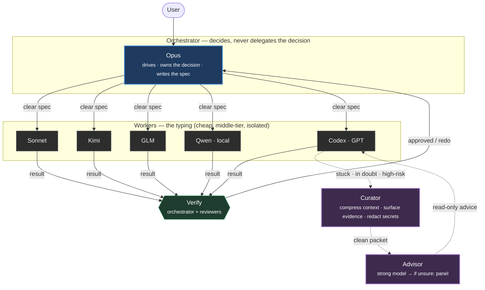

# askup

> An advisory channel for delegated AI workers. When a cheap worker gets stuck, it can **ask up** — escalate a curated problem to a stronger model — instead of guessing.

**Status: design phase.** The design is complete and reviewed; implementation has not started. See [`docs/architecture.md`](docs/architecture.md) and [`docs/threat-model.md`](docs/threat-model.md).

*(`askup` is a working name — will be finalized against npm/PyPI/GitHub availability before the first release.)*

---

## The problem

A good multi-model workflow looks like this:

> **An orchestrator (Opus) drives the conversation and owns every decision.** To save tokens, it delegates *clear, well-specified tasks* to cheaper middle-tier workers — Sonnet, Kimi, GLM, Qwen, a Codex/GPT tier, local models. Work comes back and is **verified** — by the orchestrator, and cross-checked by other reviewers. This works well.

But there's a gap: **the workers can't talk to each other.** A Claude session can spawn an advisory subagent when it's stuck. A Kimi worker running in an Ollama tool loop, or a GPT worker inside a sandbox, cannot — it's isolated. When such a worker hits something above its weight class, it either **guesses** (bad) or **dead-ends** (wasteful).

`askup` is the missing channel: a worker packages its problem, a **curator** model compresses the mess into clean evidence, and the whole thing **escalates to a higher-tier advisor**. The advisor answers; the worker continues. Ownership never leaves the orchestrator.

## How it works

**Solid lines** are the everyday flow — delegate and verify, every task. **Dashed lines** are the advisory channel — it opens *only when a worker is stuck.*

Any engine can open it:
- a **Claude** worker via a subagent,
- a **Codex / GPT** worker via `claude -p` (or a peer GPT advisor),
- an **Ollama** worker via a `consult_advisor` tool in its loop.

## Design principles

- **Provider-agnostic.** Roles (curator, advisor, panel) map to models in one config file. No model names are hardcoded. Anthropic, OpenAI/Codex, Ollama, and any OpenAI-compatible endpoint are adapters.
- **The advisor advises; it never decides.** `askup` returns a structured recommendation with a confidence score and any dissent. The caller stays the decision-owner.
- **Two hops on purpose.** A high-context, cheap *curator* turns a weak worker's messy dump into a tight, fact-vs-assumption packet, so the expensive advisor spends its tokens reasoning, not parsing. (Optional; off by default.)
- **Fail-closed on sensitive data.** Mark a request sensitive and only `trusted`/`local` advisors are eligible — third-party providers are skipped, never silently used. Secrets are redacted before any cross-model send.
- **Clean & simple.** One command to install, one small config file to configure, `askup doctor` to tell you what's reachable.

## Security posture (read this)

This tool ships *your code's context* to model providers, so security is first-class — see [`docs/threat-model.md`](docs/threat-model.md). Three things worth stating up front:

1. **The advisor runs with no tools by default** — the curated packet is its entire world. "Read-only" is *not* a safety guarantee: a filesystem-equipped advisor reachable through an injectable packet could read local secrets and echo them back. Filesystem access is opt-in, directory-scoped, and restricted to read-only tools. **One exception to know:** the `codex-cli` adapter (`codex exec -s read-only`) is a *read-capable agent*, not a no-tools advisor — prefer the `openai` adapter for a request-shaped OpenAI advisor, and never point `codex-cli` at sensitive data. See [`docs/threat-model.md`](docs/threat-model.md).
2. **The returned recommendation is untrusted input.** It is aimed at the *weakest* model in the system. Never pipe an advisor's implementation guidance to a shell unexamined; output is schema-validated and linted for embedded shell/network commands.
3. **Redaction is best-effort** against *accidental* leakage, not adversarial encoding. No telemetry — `askup` phones home to nobody but the model providers you configure.

## Non-goals

Not an agent runtime, task router, workflow engine, or model gateway. `askup` does exactly one thing: **controlled escalation from a weaker executor to a stronger advisor, with context curation and safety.**

## License

MIT © Pher217
